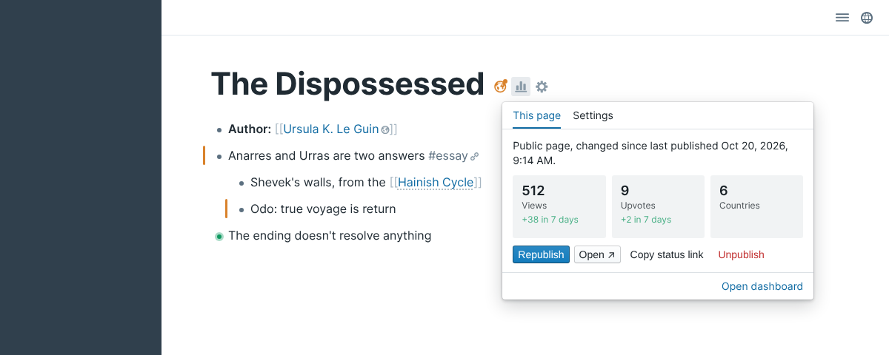
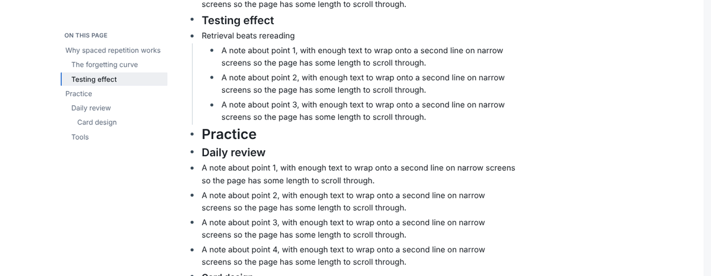
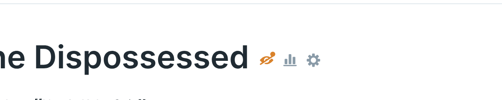
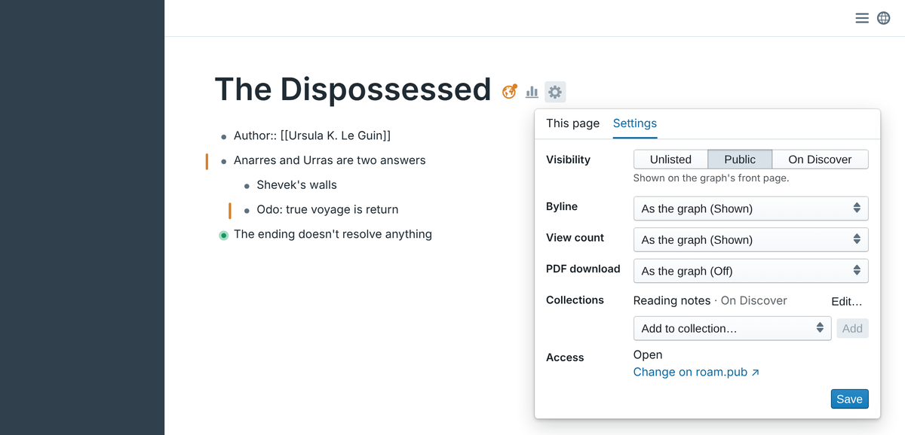
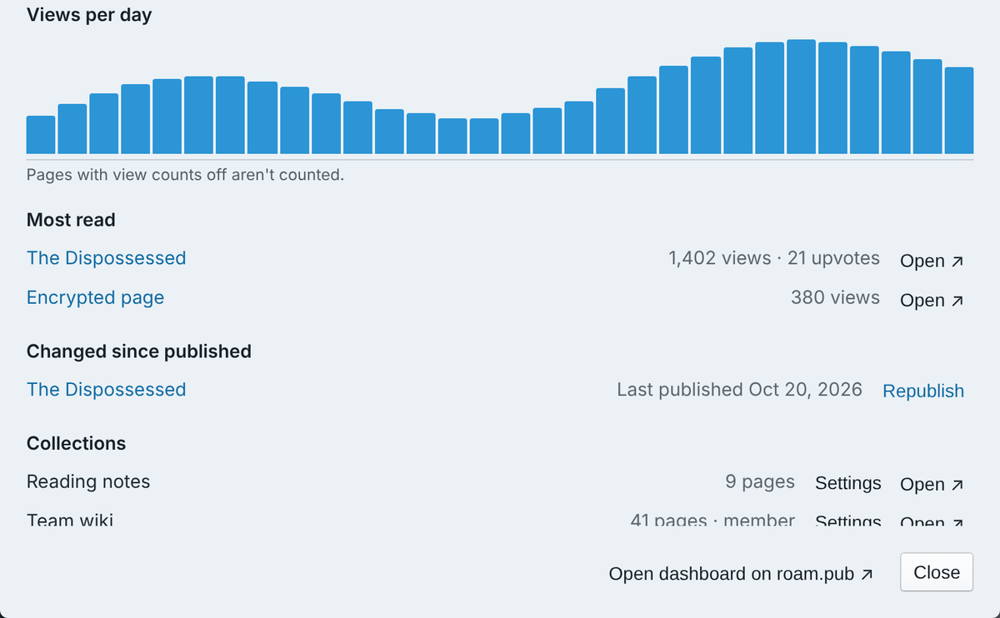

# Roam Publish

**Publish Roam pages and blocks to the web as clean, shareable pages on [roam.pub](https://roam.pub). See each page's
status, views and settings without leaving Roam.**

[Example page](https://roam.pub/ejqs/DyEQxo40V/roam-publish-kitchen-sink) · [What's new](https://roam.pub/updates) ·
[Changelog](https://github.com/ejqs/roam-publish/blob/main/CHANGELOG.md) · [Report an issue](https://github.com/ejqs/roam-publish/issues)

> Roam Publish is a third-party service made by [@ejqs](https://ejqs.net). It is not affiliated with Roam Research.

## Quick start

1. Install **Roam Publish** from Roam Depot.
2. Sign up at [roam.pub](https://roam.pub) and connect your graph with an **append-only** API token
   (Roam: Settings → Graph → API tokens). This verifies that you own the graph: roam.pub adds a block to today's
   daily note, which you can delete afterwards.
3. In Roam, open **Settings → Roam Publish**, click **Open dashboard**, copy your key and paste it into **API key**.
4. Right-click a page title and choose **Roam Publish: Page…**. Pick where it goes and its visibility, then click
   **Publish page**. The link is copied to your clipboard.

Without a key, step 4 opens the setup steps right in Roam, with a field to paste the key.

## Features

### Publish pages and blocks

Right-click a page title or bullet, or type "Roam Publish" in the command palette. One pop-up asks where it goes
(your graph, your graph encrypted, or a collection) and its visibility, before anything is published. Republish after
edits with one click. Published pages keep Roam's formatting: block references, embeds, tables, kanban boards, math, code, Mermaid
diagrams, images and video. Readers can fold blocks and zoom in, as in Roam.

### Access and visibility controls

- **Visibility:** Unlisted (link only), Public (your graph's front page) or Discover (roam.pub's
  [Discover](https://roam.pub/discover)).
- **Access:** lock a page with a **Password** or to **Members**.
- **End-to-end encryption:** Password pages can be encrypted in Roam before they're sent, so roam.pub never sees
  their text or title.

### Status in Roam

Published pages show three icons after their title: status, stats and settings.

- **Status:** a globe, an eye crossed out when Unlisted, or a lock when encrypted. Green when up to
  date; orange with a dot when the page changed since you last published it.
- **Blocks:** a ring on blocks published on their own, and a bar beside blocks edited since the last publish.

Nothing is written to your graph to show these. Set **Status in Roam** to **Titles only** or **Off** to show less.

### Page settings and stats

The stats icon shows a page's views, upvotes and readers' countries. The settings icon changes its visibility,
byline, view count, PDF download and collections. Passwords and members stay on roam.pub.

### Dashboard

The globe in Roam's top bar opens your views per day, upvotes, most read pages, pages changed since publishing and
your collections, for the last 7 or 30 days or all time.

### Collections

Gather pages from different graphs and people in one place. **Add to collection…** uses each collection's own
access and visibility settings.

## Settings

| Setting | What it does |
| --- | --- |
| **API key** | Your key for this graph. Pasting it checks it and names the graph it works for. |
| **Author name** | Your byline on pages that show authors. Blank: your @username. |
| **Status in Roam** | **Titles and blocks** (default), **Titles only** or **Off**. |
| **Top bar button** | On (default): a globe in Roam's top bar opens the dashboard. |
| **Collapsed blocks** | **As in Roam** (default) or **Expanded** on a first publish. |
| **Roam Publish block** | **Off** (default for new installs): nothing is written to your graph. Or a block with the status link, where roam.pub writes the change log: **Pages**, **Pages and blocks** or **Blocks only**. |
| **Block position** / **Block tag** | Where that block goes and its text (default `[[Roam Publish]]`). |

## Privacy

- **Only on your action.** Nothing leaves Roam until you publish. No analytics; the only server contacted is roam.pub.
- **Written to your graph:** nothing, unless you turn on the Roam Publish block; then that block when you publish, and
  change log entries if you keep an append-only token. That token can only add blocks. It can't read, edit or delete anything.
- **Background requests:** status link uids about every 5 minutes, and your published pages list at most every 10
  minutes. Both stop when the matching setting is **Off**.

Full details: [Data flow and the Append API](https://github.com/ejqs/roam-publish-docs/blob/main/docs/data-and-append-api.md),
[Privacy policy](https://roam.pub/privacy), [Terms](https://roam.pub/terms).

## Help

- **Shared graphs, lost keys, supported blocks:** see the [guide](https://github.com/ejqs/roam-publish-docs/blob/main/docs/extension-guide.md).
- **Bugs and ideas:** [open an issue](https://github.com/ejqs/roam-publish/issues) or email support@roam.pub.
- **Security issues:** report privately to support@roam.pub.

## Credits

Adapts code from [roamjs-components](https://github.com/RoamJS/roamjs-components) (MIT, Copyright (c) 2021 David
Vargas). In-Roam marks follow [Reference Count](https://github.com/fbgallet/roam-extension-ref-count) by Fabrice
Gallet (MIT). Development and release notes: [CONTRIBUTING.md](https://github.com/ejqs/roam-publish/blob/main/CONTRIBUTING.md).

[MIT](https://github.com/ejqs/roam-publish/blob/main/LICENSE)
